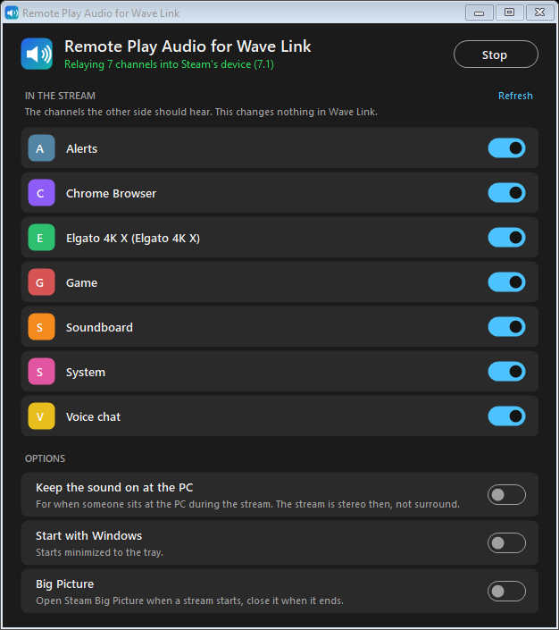
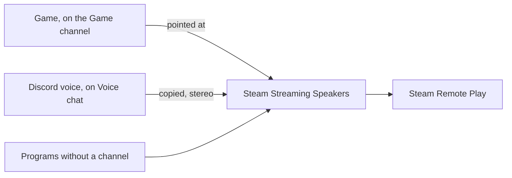

# wavelink-remote-play

You stream games from your PC with Steam Remote Play, to a Steam Deck, a phone or the TV in the living room. You also use Elgato Wave Link on that PC. On the other end you hear system sounds and little else: no game, no browser, no voice chat. Or you hear everything, but only in stereo.

This small Windows tool fixes that. It sits in the tray and notices when a stream starts. While the stream runs, your Wave Link channels play into the stream, games in full surround. When the stream ends, everything goes back to where it was. You don't have to change your Wave Link mixes.



This is a hobby project. It is not made or endorsed by Elgato or Valve.

## Quick start

1. **Get the tool.** Download the zip from the [Releases](https://github.com/dev-kalleno/wavelink-remote-play/releases/latest) page, unpack it anywhere and start `wavelink-remote-play.exe`. The exe isn't signed, so Windows SmartScreen will probably ask once ("More info", then "Run anyway"). If you'd rather not run a stranger's exe, [build it yourself](#build-it-yourself) with one command.
2. **Take Steam out of your Wave Link channels.** Open Wave Link and look at the programs listed in each channel, usually it is "System". If Steam is in there, remove it. This one entry is the reason Steam only streams that channel, see [Why this happens](#why-this-happens).
3. **Switch off the device lock in Wave Link.** In Wave Link's settings, under audio devices, there is a lock that keeps the Windows output device on "System". With the lock on, the stream works but stays stereo.
4. **In the tool, switch on "Start with Windows".** The channels are all switched on already.

That's it. Connect from your Deck or phone. Within about a second the line under the title turns green.

For surround, the device you stream to has to ask for it: set the audio channels in Steam's Remote Play settings there to 5.1 or 7.1. And the game has to output surround, of course.

## The window

| Part | What it does |
| --- | --- |
| Start / Stop | Switches the tool on and off by hand. It starts by itself when you open it. |
| In the stream | One switch per Wave Link channel. On means the other side hears this channel. |
| "direct: ..." on a row | The programs of this channel that are playing straight into the stream right now. |
| Refresh | Reads the channel list again, for example after you added a channel in Wave Link. |
| Keep the sound on at the PC | For when someone sits at the PC during the stream. The stream is stereo then, not surround. Off by default. |
| Start with Windows | Starts the tool with Windows, minimized to the tray. No admin rights needed. |
| Big Picture | Opens Steam Big Picture on the PC when a stream starts, reopens it after you quit a game, and closes it 20 seconds after the stream has ended. Off by default. |
| A yellow line under the title | Something in your setup keeps the stream stereo, and what to change. See [If something is wrong](#if-something-is-wrong). |

Closing the window only hides it. The tool keeps running in the tray, and "Exit" in the tray icon's menu quits it.

## What happens during a stream

1. A client connects. Steam starts recording its own playback device, "Steam Streaming Speakers", with as many channels as the client asked for.
2. The programs in your switched-on channels are pointed at that device. A game now plays straight into the stream, in stereo, 5.1 or 7.1, whatever the stream has. At the PC these programs are silent meanwhile.
3. Some things can't be pointed anywhere: a program that has its output device set in its own settings (Discord's voice output often is), or a hardware input like a capture card. Whatever is still playing on a channel is copied into the stream instead, in stereo.
4. 20 seconds after the stream has ended, every program is pointed back at its channel.

Nothing in Wave Link's own channel lists is changed. The tool uses the same Windows setting Wave Link uses, the one behind "App volume and device preferences", and puts it back afterwards.



## Good to know

- **Someone at the PC?** Switch on "Keep the sound on at the PC". Then nothing is pointed anywhere, everything is copied, and the PC keeps its sound. The price is a stereo stream. That is the right mode for Remote Play Together or a Steam Broadcast, where you play at the PC yourself.
- **Wave Link sometimes takes a program back.** When a program appears on or disappears from one of its channels, Wave Link puts the programs it knows back on their channels. The tool notices within half a second and points them at the stream again. You may hear a short dropout. In an 80 minute session I didn't notice any, I only saw it when I restarted the tool.
- **A game that keeps running after the stream** was started with the stream's channel layout and is then back on a stereo channel. I have seen games go silent when 8 channels meet a stereo device. If that happens at the PC, restart the game. I haven't tried this direction myself.
- **Starting a game from the client's library** makes Steam end the stream and start a new one 5 to 10 seconds later. The tool pauses for that gap and picks up again.
- **Volume.** A program that plays straight into the stream arrives at its own volume, Wave Link's fader for the channel doesn't apply. Copied channels arrive at full level too: the tool reads how far a channel is turned down in Wave Link and undoes it, up to +30 dB. So you can have the game quiet at your desk and loud on the TV.
- **Copied audio is about 50 ms late.** Audio that plays straight into the stream is not delayed.
- **Without Wave Link** the window lists every playback device, switched off, and you pick the ones you want. I haven't tested that.

## If something is wrong

**Yellow line: "Steam sits in Wave Link's "System" channel".**
Step 2 of the quick start. Remove Steam from that channel in Wave Link, then reconnect.

**Yellow line: "Steam records "System": stereo only".**
Step 3 of the quick start. The lock in Wave Link is on. Switch it off, then reconnect.

**Yellow line: "Windows' default output is still Steam's device".**
Steam switches the Windows output device to its own while streaming and switches it back afterwards. If Steam crashed in between, it stays. Set your output device back in the Windows sound settings.

**The stream is stereo, and there is no yellow line.**
Check the audio channel setting in Steam's Remote Play settings on the device you stream to, and the speaker setting in the game.

**A program is missing in the stream.**
Is its channel switched on in the tool? If yes, look into the log.

**Anything else.**
The tool writes `wavelink-remote-play.log` next to the exe. It says when a stream was detected, which device Steam records and with how many channels, which programs were pointed at the stream and which channels are copied. Steam's side is in `Steam\logs\streaming_log.txt`, look for `Recording on device`.

## Why this happens

Steam Remote Play records one playback device. When a client connects, Steam makes its own "Steam Streaming Speakers" the Windows default device, and records the default device. On a plain PC every program plays on the default device, so everything is in the stream.

Wave Link gets in the way in three places.

1. **Wave Link gives every channel its own playback device** and assigns your programs to them. A game on the Game channel plays on Wave Link's "Game" device, not on the default device. Steam never hears it. This is what the tool takes care of.
2. **Steam itself can end up in a channel.** Wave Link assigns programs with a Windows setting that gives one program its own default device. If Steam is listed in the "System" channel, Windows tells Steam that "System" is the default device, whatever the real default is. Steam then records "System" and nothing else, in stereo. It took me over a month to find this one. Everything I tried on Steam's side bounced off, because Steam was doing exactly what Windows told it.
3. **The device lock** puts the default device back on "System" the moment Steam changes it. Steam then records "System" too.

You can see which case you are in. While a stream runs, Steam writes this into `Steam\logs\streaming_log.txt`:

```
[System Windows] Recording on device: System (Elgato Wave XLR Pro)
Initializing audio with 2 channels and 48000 samples/sec
```

That is case 2 or 3. This is how it should look:

```
[System Windows] Recording on device: Lautsprecher (Steam Streaming Speakers)
Initializing audio with 8 channels and 48000 samples/sec
```

("Lautsprecher" because my Windows is German. Yours will say "Speakers".)

If you don't care about surround, you don't strictly need this tool once Steam records its own device: you can add "Steam Streaming Speakers" as an extra output to one of your Wave Link mixes. Everything in that mix should then reach the stream, in stereo. I haven't gone back to check that.

## Build it yourself

Everything is in one file, `relay.cs`, with no dependencies. `build.cmd` compiles it with the C# compiler that ships with Windows 10 and 11, so you don't need to install anything:

```
.\build.cmd
```

You get `wavelink-remote-play.exe` (the window) and `wavelink-remote-play-cli.exe` (for the terminal). The icon comes from `make-icon.ps1`, in case you want other colors.

## Command line

The window is all most people need. If you prefer a terminal:

```
.\wavelink-remote-play-cli.exe --list
.\wavelink-remote-play-cli.exe
```

| Option | Meaning |
| --- | --- |
| `--list` | show playback devices and their ids |
| `--source <id,id>` | the devices to put into the stream. Default: Wave Link's channels. |
| `--target <id>` | device to play into. Default: whatever device Steam records. |
| `--keep-local` | same as "Keep the sound on at the PC" |
| `--raw` | don't undo the Wave Link faders on copied channels |
| `--always` | don't wait for a stream, copy until closed |
| `--verbose` | log the level of the copied audio every 5 seconds |
| `--selftest` | open the devices, run for 2 seconds, exit |
| `--minimized` | window version only: start in the tray |

Settings from the window are stored in `%APPDATA%\wavelink-remote-play\settings.ini`.

## Tested on

Only my own setup: Windows 11, Wave Link 3.5 (beta), an Elgato Wave XLR Pro and the Steam beta client. The client was a Steam Deck with a surround system behind it, where a test tone came from the front and the back speakers as it should. Earlier versions also ran with an iPhone (Steam Link) and a MacBook. Other setups may behave differently, so tell me if yours does.

Version 1 of this tool was called steam-audio-relay. It only copied audio into "System" in stereo, because I hadn't found the real cause yet.

## Thanks

The Windows interface for assigning a program to a playback device isn't documented. I took its layout from [EarTrumpet](https://github.com/File-New-Project/EarTrumpet).

## License

MIT, see [LICENSE](LICENSE).
